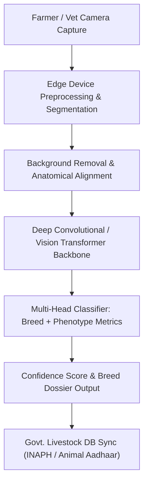

# 🐄 SIH 2025: Image-Based Breed Recognition for Cattle & Buffaloes of India

Project proposal and technical architectural specification for **Smart India Hackathon 2025** — **Problem Statement ID: 25004**: *Image-based breed recognition for cattle and buffaloes of India*.

---

## 📌 Problem Statement Overview
India possesses one of the world's most diverse indigenous livestock populations. However, accurate breed identification currently requires rare veterinary and zoological field experts. Misidentification causes sub-optimal breeding programs, loss of pure indigenous genetics, and inadequate financial credit/insurance appraisal for rural dairy farmers.

### 🎯 Core Objectives
1. **Automated Vision-Based Breed Classification**: Accurately recognize indigenous Indian cattle and buffalo breeds from standard smartphone photographs.
2. **Multi-Feature Morphometric Analysis**: Extract salient biological features including body profile, coat pattern, horn structure, facial contour, and hump geometry.
3. **Low-Resource Mobile Edge Deployment**: Quantized, offline-capable inference runnable on budget Android devices used by field veterinarians and farmers.

---

## 🏗️ Technical Architecture

---

## 💡 Social & Economic Impact
- **Farmer Empowerment**: Instant breed verification on farm without expert call-out delays.
- **Indigenous Breed Conservation**: Protects purity of breeds like Gir, Sahiwal, Red Sindhi, Murrah, and Jaffarabadi.
- **Fintech & Insurance Integration**: Direct integration with cattle insurance underwriting and government subsidy schemes.

---

## 📂 Included Artifacts
- **[Hackathon.pptx](Hackathon.pptx)**: Complete 8-slide pitch deck detailing the technical feasibility, dataset acquisition strategy, and implementation roadmap.
